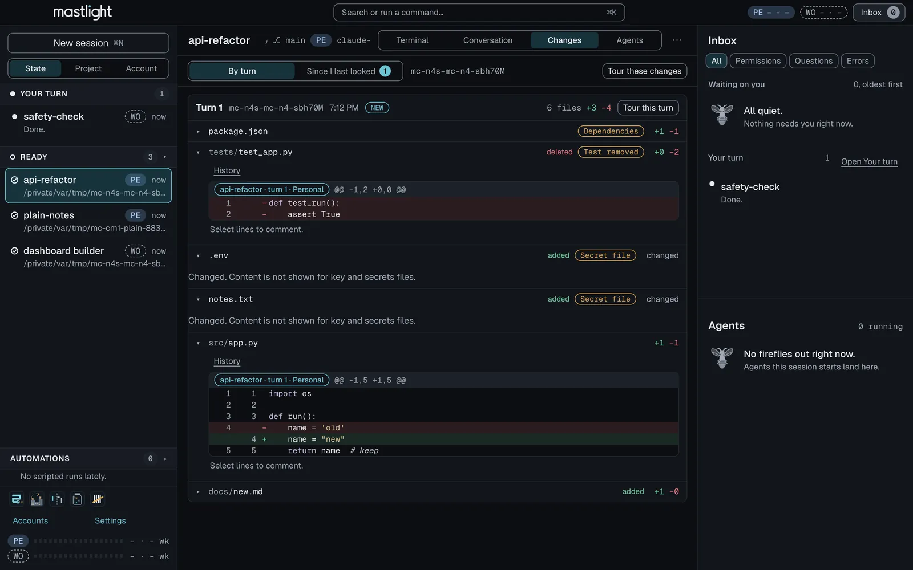
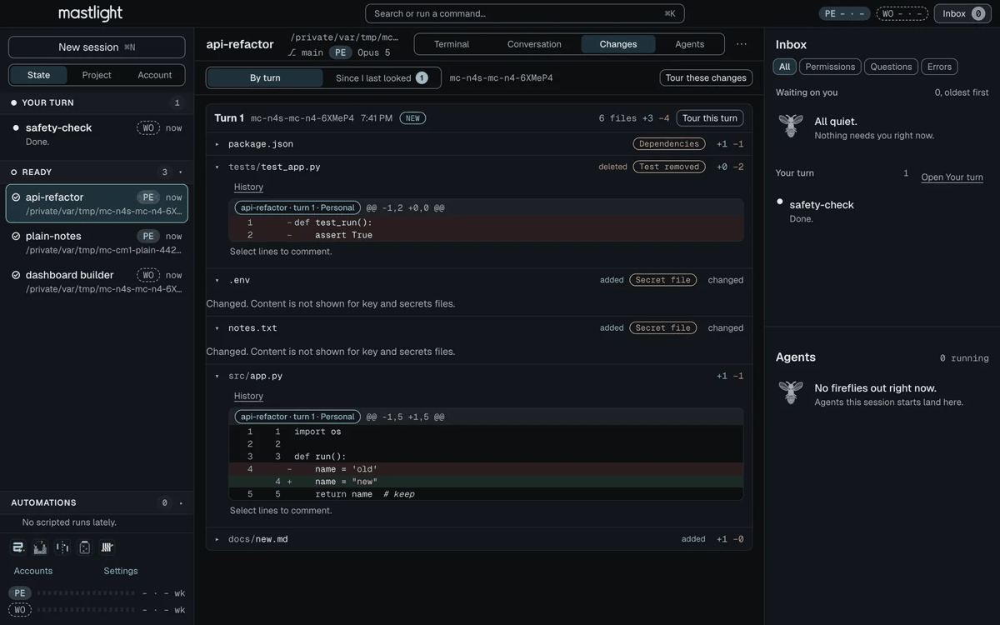
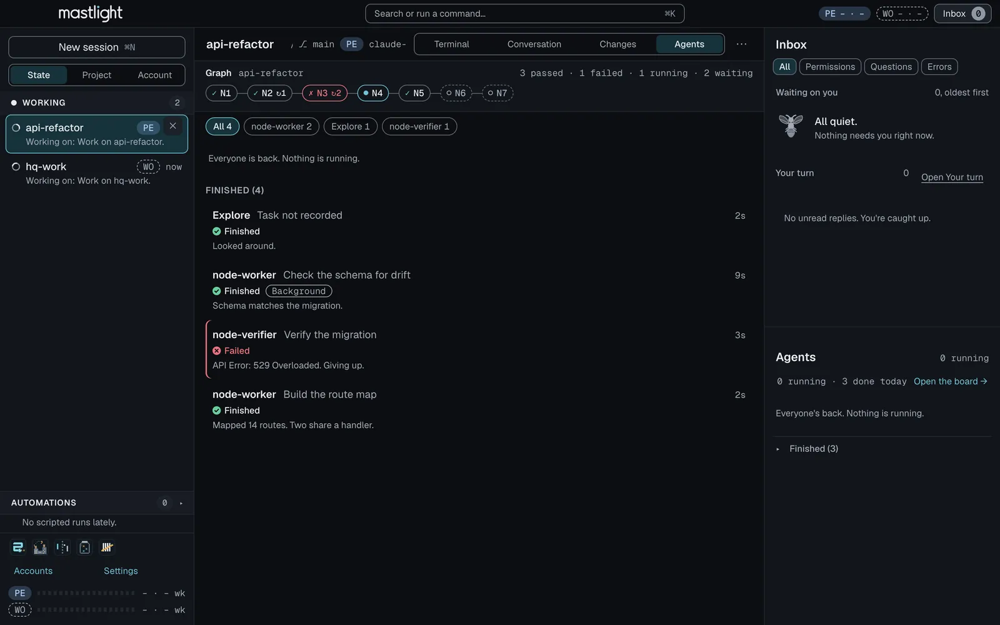
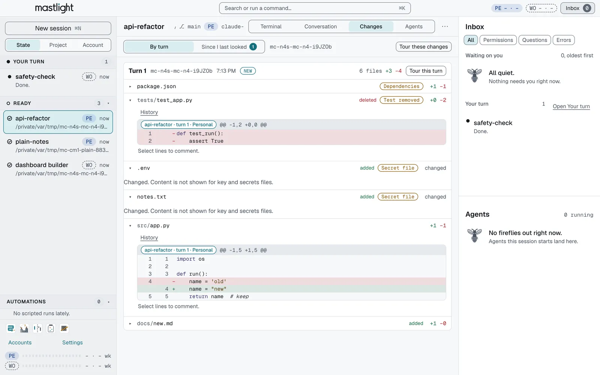
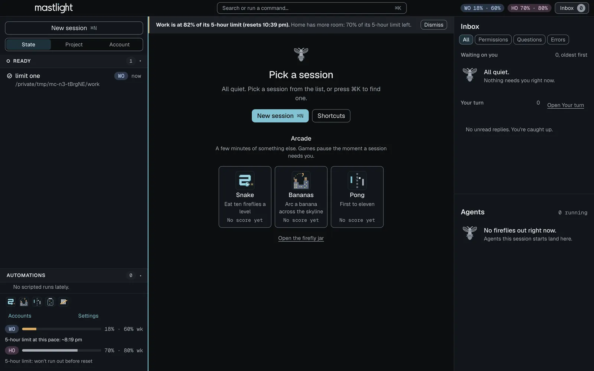
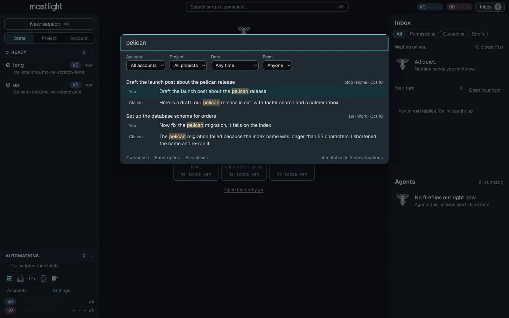

# Mastlight

**Every session, one calm board.** Mastlight is an app for Mac and Windows for people who keep a lot of Claude Code sessions going at once, on one account or several. Every session tells you what it needs, and you answer it in one place. No more tab safari.

  <picture>
    <source media="(prefers-color-scheme: light)" srcset="docs/img/changes-light.png">
    
  </picture>

<a href="https://mastlight.io">mastlight.io</a> · <a href="https://mastlight.io/start">Getting started</a> · <a href="https://github.com/josephwheeler123/mastlight/releases/latest">Releases</a> · <a href="https://github.com/josephwheeler123/mastlight/discussions">Discussions</a>

Mastlight is in **early preview**. It is free, it has no account and no telemetry, and it is not signed yet (see Download).

## Download

Current version: **1.1.10** (Mac). Windows stays on **1.1.8** for this release.

| | File | For | Size | SHA-256 |
|---|---|---|---|---|
| **Mac** | [Mastlight-arm64.dmg](https://github.com/josephwheeler123/mastlight/releases/latest/download/Mastlight-arm64.dmg) | Apple silicon (M1 or newer), macOS 13 (Ventura) or later | 147.7 MB | `44cb91e80064bce529f163ce80c5ef587136943033c551c0d7100354d133458f` |
| **Windows** (new) | [Mastlight-Setup-x64.exe](https://github.com/josephwheeler123/mastlight/releases/latest/download/Mastlight-Setup-x64.exe) | Intel or AMD PCs, Windows 10 (1809) or 11 | 123.7 MB | `89580c274d0bff7945e96594ba79e98159a58a4ab46faa8daabb3d2b4b9d6d9a` |
| **Windows on Arm** (new) | [Mastlight-Setup-arm64.exe](https://github.com/josephwheeler123/mastlight/releases/latest/download/Mastlight-Setup-arm64.exe) | Arm PCs (Snapdragon, Surface Pro X), Windows 10 (1809) or 11 | 116.8 MB | `4f50000494989f4cd26c6e873e3d036c805b1e2d80b8a097870ec6f9f4bbcfcc` |

Every file is also on the [release page](https://github.com/josephwheeler123/mastlight/releases/latest). Check a download yourself if you like: `shasum -a 256 ~/Downloads/Mastlight-arm64.dmg` on a Mac, `Get-FileHash .\Mastlight-Setup-x64.exe` in PowerShell on Windows.

**The builds are not signed.** There is no Apple Developer ID or Windows code-signing certificate behind them yet.
- **Mac:** open the DMG, drag Mastlight onto Applications. On first open macOS refuses; choose Done, then go to System Settings, Privacy & Security, click **Open Anyway** next to Mastlight and confirm (macOS 15 and later no longer accept right-click and Open). If macOS says the app is "damaged" and offers no Open Anyway, run `xattr -dr com.apple.quarantine /Applications/Mastlight.app` once in Terminal.
- **Windows:** run the installer. SmartScreen says "Windows protected your PC": choose **More info**, then **Run anyway**. No administrator prompt.
- **Windows is new and untested on real PCs.** 1.1.2 was the first public Windows release; 1.1.8 is current (1.1.10 is Mac only). It was built and checked on a Mac, not run on a real Windows PC yet, so expect rough edges and please [tell us](#reporting-bugs) what you find.

Step by step, with pictures, on each system: **<https://mastlight.io/start>**.

## What it does

- **Every session in one list**, from one account or several. Group by state, by the repo each really works in, or by account, with each account's 5-hour and weekly limit in view.
- **One inbox.** Whatever is waiting on you lands there, oldest first, and you answer it right there.
- **Exact cards.** A permission request, plan or question shows the real command, plan or question with its options. Answer from the keyboard (from the message box, Option+1 allows once and Option+3 denies; Alt+1 and Alt+3 on Windows). There is no approve-everything button, on purpose.
- **Terminals that survive quitting.** Each session runs in a built-in terminal owned by a small background helper, so quitting or updating Mastlight leaves sessions running; open it again and every tab reattaches. After a crash or reboot it offers to restore them.
- **Your turn.** Finished sessions queue up oldest first, each with a reply box and your most-used quick replies.
- **Change Map.** A Changes tab shows every file each session changed after every turn, including edits made by Bash and subagents, flags the ones worth a look (deleted tests, lockfiles, migrations, secret-looking files), and works from copies, so it never writes to your repo. Step back through a file's history, comment on lines and send the comment to the session that made them.
- **Agent Board.** Every subagent a session launched, running or finished, with task, model, outcome and transcript, plus a strip showing a `GRAPH.md`'s progress.
- **Limits Pilot.** Each account's gauge forecasts when the limit will run out, warns at 80% and 95%, and shows when another account has more room. It never switches accounts for you.
- **Search every conversation.** Claude Code deletes its own transcripts after 30 days; Mastlight keeps its own copy (secrets redacted in the index) and searches all of it.
- **And some calm.** A Firefly jar that shows every live session at a glance, a small arcade for the minutes while a turn runs, a daily tally, launch presets, replay export, and dev-container sessions.

  

A slideshow of the screenshots, not a recording. The sample sessions in them are made up.

| Agent Board | Changes |
|---|---|
| <picture><source media="(prefers-color-scheme: light)" srcset="docs/img/agent-board-light.png"></picture> |  |

| Limits Pilot | Search |
|---|---|
|  |  |

## Requirements

- **Mac:** Apple silicon (M1 or newer), macOS 13 (Ventura) or later.
- **Windows:** an Intel, AMD or Arm PC with Windows 10 (version 1809) or 11. Git for Windows is recommended (Claude Code uses Git Bash when it is installed and PowerShell when it is not). Folders inside WSL are not supported yet.
- **Claude Code 2.1.85 or newer**, the first version where a hook can answer a question. Setup checks the version it finds.
- **A Claude subscription.** You sign in with your own; one account is plenty, more is fine. Each account has to be yours.

## Privacy

- No account, no telemetry, no server of ours. Everything runs on your computer.
- The one request the app makes by itself is a once-a-day check for a newer version. You can switch it off in Settings. Mastlight never downloads or installs an update by itself.
- Mastlight never sees, stores or types a Claude credential. Signing in is Claude's own `/login`, run in a terminal inside Mastlight. It reads only the email and plan of each account, never a token.
- Your own Claude settings files are never edited: the hook that shows cards is passed to each session on its command line.
- Claude Code itself talks to Anthropic as it always does.

## What is open and what is not

This repository holds **release downloads, this README and the issue tracker**. The **source code is not public**. Mastlight is proprietary — all rights reserved (see [LICENSE](LICENSE)); the installers are free to download and use, and no open-source license is granted; the third-party software the app bundles keeps its own licenses, which ship inside the app. If that matters for what you want to do, ask: hello@mastlight.io.

## Reporting bugs

- [Open an issue](https://github.com/josephwheeler123/mastlight/issues/new/choose). Say which version you have, whether you are on a Mac or Windows, and what happened. Issues are public, so leave out anything private (paths, project names, conversation text).
- Or email **hello@mastlight.io**.
- Questions, ideas and "here is how I use it" go in [Discussions](https://github.com/josephwheeler123/mastlight/discussions).
- Security problems: see [SECURITY.md](SECURITY.md).

## FAQ

The common questions (Is it made by Anthropic? Can I use more than one account? What does it send over the network? How do I remove it?) are answered at **<https://mastlight.io/#faq>**, and the first-open steps are at **<https://mastlight.io/start>**.

Mastlight is an independent app and is not affiliated with or endorsed by Anthropic. Claude and Claude Code are trademarks of Anthropic.
